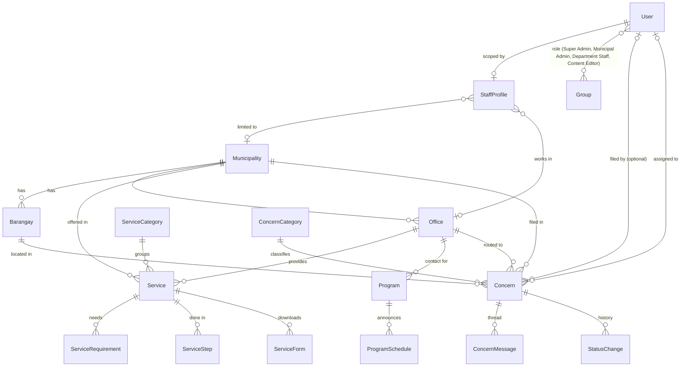

# SibuyanConnect: database schema

The Django models are the source of truth. Each app's `models.py` holds the full field list, and
`*/migrations/0001_initial.py` holds the generated SQL schema. This page summarises them.

**Conventions**
- `municipality` FK, **empty = island-wide**. `TownQuerySet.for_town(town)` returns that town's
  records plus island-wide ones. This is how the town switcher filters everything.
- Fields marked **(T)** are translated by django-modeltranslation into `<field>_en`, `<field>_fil`
  and `<field>_rol` columns.
- `created_at` / `updated_at` come from `core.TimeStampedModel`.

## Entity relationships (core of the prototype)

## Users and roles (`django.contrib.auth` + `core`)

| Model | Key fields | Notes |
|---|---|---|
| `auth.User` | username, email, password, is_staff, groups | Staff and optional citizen accounts |
| `auth.Group` | name, permissions | Created by `setup_roles`: Super Admin, Municipal Admin, Department Staff, Content Editor |
| `core.StaffProfile` | user (1:1), municipality?, office?, position | Scopes admin querysets: office → only that office's tickets; municipality → that town's records |

## Core (`core`)

| Model | Key fields |
|---|---|
| `Municipality` | name, slug, code (`MAG`/`SFE`/`CAJ`, used in ticket numbers), tagline (T), description (T), lat/lng, order |
| `Barangay` | municipality, name (unique per town) |
| `Office` | municipality, kind (Mayor, MDRRMO, MSWDO, MENRO, Engineering, Health, Agriculture, MCR, Treasury, BPLO, Tourism, OSCA, PDAO), name, head, email, phone, location, office_hours, lat/lng. Unique (municipality, kind) |
| `Alert` | municipality?, kind (typhoon, ferry, power, water, road, health, other), level (info, warning, danger), title (T), body (T), source_url, starts_at, ends_at, is_active, notify_subscribers |
| `AlertSubscription` | email, municipality?, consent_given_at, is_active |

## Services Directory (`services`)

| Model | Key fields |
|---|---|
| `ServiceCategory` | name (T), slug, icon, order |
| `Service` | municipality?, category, office?, name (T), slug, summary (T), who_may_apply (T), fees (T), fee_amount, processing_time (T), office_hours, legal_basis, is_published, view_count |
| `ServiceRequirement` | service, order, text (T), where_to_get (T), **condition (T)**, is_optional. An empty condition means always required. Otherwise the yes/no question that switches it on in the checklist generator |
| `ServiceStep` | service, order, description (T), responsible, duration |
| `ServiceForm` | service, title (T), file or external_url |

## Programs & Assistance (`programs`)

| Model | Key fields |
|---|---|
| `Program` | municipality?, level (municipal, provincial, national), kind (scholarship, livelihood, cash, senior & PWD, agri, health), agency, name (T), slug, summary (T), benefits (T), how_to_apply (T), contact_office?, official_url, view_count |
| ↳ eligibility rules | min_age, max_age, max_monthly_income, requires_student, requires_farmer, requires_fisherfolk, requires_farmer_or_fisherfolk, requires_pwd, requires_solo_parent, requires_indigenous, requires_informal_worker, requires_in_crisis, requires_listahanan_poor, eligibility_notes (T). Every rule that is set must pass (`Program.evaluate`) |
| `ProgramSchedule` | program, municipality?, title (T), opens_on, closes_on, venue, notes (T) |

## Report a Concern (`concerns`)

| Model | Key fields |
|---|---|
| `ConcernCategory` | name (T), slug, description (T), icon, **office_kind**, which routes the ticket to that kind of office in the citizen's town |
| `Concern` | **ticket_number** (`SC-<TOWN>-<YEAR>-<00000>`), access_token (private link), municipality, barangay, category, office (auto-routed, staff may re-route; falls back to the Mayor's Office), assigned_to?, status (received → assigned → in_progress → resolved), priority, subject, description, location_detail, photo (compressed, EXIF stripped), citizen user?, name, email, phone, **consent_given_at**, **privacy_notice_version**, source (web or assistant), resolved_at |
| `ConcernMessage` | concern, sender (citizen, staff, system), author?, body, is_internal (staff-only note), created_at |
| `StatusChange` | concern, from_status, to_status, changed_by?, note, created_at. Audit trail and analytics source |

## News & Events (`news`)

| Model | Key fields |
|---|---|
| `Post` | municipality?, category (LGU, advisory, event, health, agriculture, education), title (T), slug, summary (T), body (T), image, is_pinned, is_published, published_at, author |
| `Event` | municipality?, kind (fiesta, festival, LGU, community), title (T), slug, description (T), starts_on, ends_on, venue (T), lat/lng, cover |
| `EventPhoto` | event, image, caption (T), credit |

## Tourism (`tourism`)

| Model | Key fields |
|---|---|
| `Attraction` | municipality, kind (mountain, falls, river, beach, cultural, viewpoint), name, slug, summary (T), description (T), tips (T), guide_requirement (T), environmental_fee, fee_notes (T), is_protected_area, within_ancestral_domain, is_open, closure_note (T), lat/lng, cover |
| `ClimbAdvisory` | attraction, trail, status (open, restricted, closed), season_note (T), permit_requirements (T), valid_from, valid_until, issued_by (DENR-PAMO), source_url |
| `Business` | municipality, kind (accommodation, restaurant, guide, transport, tour operator), name, description (T), address, phone, email, is_accredited, accredited_by, accreditation_no, lat/lng |
| `TravelRule` | scope (general, protected areas, ancestral domain of the Sibuyan Mangyan Tagabukid), title (T), body (T) |

## Transport (`transport`)

| Model | Key fields |
|---|---|
| `Route` | municipality (port town), port, origin, destination, operator, vessel, schedule_text (T), duration, fare_info, notes (T), is_active |
| `Trip` | route, departure_date, departure_time, **status** (on time, delayed, cancelled, departed), status_note (T), updated_at, updated_by. Port and LGU staff edit status straight from the admin list |
| `JeepneySchedule` | origin town, destination town, terminal, departure_time, days, fare |
| `TricycleFare` | municipality, from_point, to_point, regular_fare, discounted_fare, special_trip_fare, ordinance |

## Emergency (`emergency`)

| Model | Key fields |
|---|---|
| `Hotline` | municipality?, agency (national, MDRRMO, PNP, BFP, hospital, RHU, Coast Guard, power, other), name (T), number, alt_number, is_24h, order, **is_verified** |
| `EvacuationCenter` | barangay, name, capacity, facilities, lat/lng |
| `PreparednessGuide` | hazard (typhoon, flood, landslide, earthquake, storm surge), title (T), body (T, one tip per line) |

## Marketplace & Jobs (`marketplace`)

| Model | Key fields |
|---|---|
| `Listing` | municipality, kind (honey, balitsaw, woven, farm, fish, other), title, description, price, unit, seller_name, contact_phone, image, **is_approved**, expires_on |
| `JobPosting` | municipality?, kind (LGU, private, livelihood), employer, title, description, pay, how_to_apply, deadline, **is_approved** |

## Transparency & Environment (`civic`)

| Model | Key fields |
|---|---|
| `PublicDocument` | municipality?, kind (ordinance, resolution, EO, budget, procurement, Citizen's Charter, report), number, title (T), summary (T), date_issued, file or external_url |
| `Official` | municipality, name, position, office?, term, email, phone, order |
| `EnvironmentUpdate` | municipality?, kind (protected area, conservation, clean-up, report), title (T), body (T), **source** (required, so posts stay factual and attributed), source_url, image, published_at |

## Help Assistant (`assistant`)

| Model | Key fields |
|---|---|
| `FAQEntry` | municipality?, topic, question (T), answer (T), keywords (T), link_url, is_published |
| `AssistantQuery` | question, language, layer (faq, site, llm, none), created_at. Anonymous; `layer = none` shows FAQ gaps |
